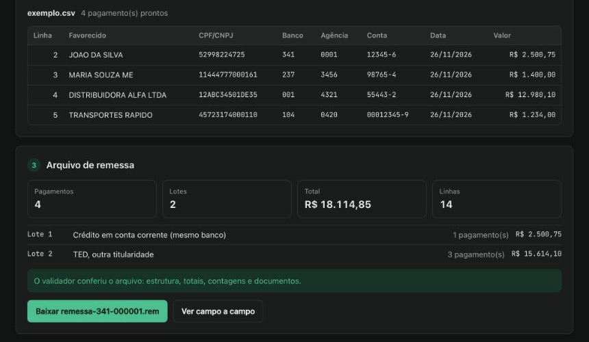
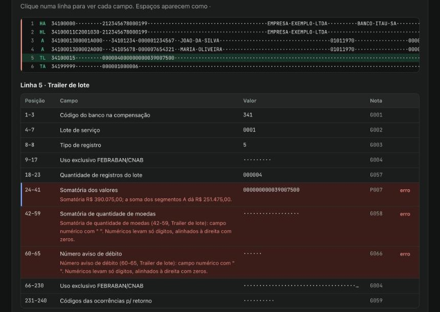

# cnab-generator

Generate and validate FEBRABAN CNAB 240 payment files (*remessa de pagamentos*) from a spreadsheet, in the browser.

**[Open the app](https://alajter.github.io/cnab-generator/)** · [Português](README.pt-BR.md) · [Docs](docs/README.md) · [Roadmap](docs/product/roadmap.md)



## The problem

Brazilian companies pay suppliers and salaries by sending their bank a CNAB 240 file: fixed-width text, 240 characters per line, with every field at a position defined in a 300-page FEBRABAN manual. One misplaced character and the bank rejects the whole file, usually with a code and no explanation.

The developers who build these files are rarely payments specialists. They copy a layout from an old blog post, get one bank to accept it, and find out about the edge cases in production: an amount read as a hundred times too large, a date off by one because of the time zone, an accented name, a TED (interbank transfer) in the same batch as a credit to an account at the payer's own bank.

## What it does

- **Generates** a CNAB 240 remessa from a CSV or Excel sheet. The payer's details go in a form; payments are one row each.
- **Validates** any CNAB 240 payment file, including ones made by other tools. Every problem comes with its line, its field and its positions, and the file viewer shows each field's value.
- **Runs entirely in the browser.** Payment data (names, CPF/CNPJ, accounts, amounts) never leaves the machine. There is no server.
- **A CLI and a library** for the same engine, for teams that want it in a script or a backend.



## What it gets right

| Detail | What happens |
|---|---|
| Layout | FEBRABAN 240 **v11.0** (September 2026): file version `103`, lote version `046`. Positions come from one definition that the generator, the validator and [the layout reference](docs/layout.md) all use. |
| Money | Integer centavos end to end. `2.500,75`, `2500.75` and `2,500.75` all work. `1.234` is rejected as ambiguous instead of guessed. |
| Dates | Parsed as calendar days, so `2026-01-15` cannot become the 14th in Brazil's time zone. Weekends and past dates are flagged. |
| Lotes | Same bank as the payer: credit in account (forma 01, câmara 000). Other banks: TED (forma 41, or 43 when the payee is the payer itself), câmara 018, or 988 when an ISPB is given. Each forma gets its own lote. |
| Documents | CPF and CNPJ check digits, including the **alphanumeric CNPJ** issued from July 2026. |
| Text | Upper case, no accents, CRLF line endings, numbers right-aligned with zeros, text left-aligned with spaces. A number that does not fit is an error, never truncated. |
| Totals | Trailer counts and sums are computed, then checked again by the validator. |

## What it does not do yet

Pix (formas 45 and 47), boletos (segment J), taxes (segments N and O), salary card, and reading return files (*retorno*). Banks also add their own rules on top of the standard; check your bank's manual and the [compatibility table](docs/bank-compatibility.md). See the [roadmap](docs/product/roadmap.md).

## Use it

**In the browser:** [alajter.github.io/cnab-generator](https://alajter.github.io/cnab-generator/). Click *Usar dados de exemplo* to see the whole flow in ten seconds.

**From the command line:**

```sh
git clone https://github.com/alajter/cnab-generator && cd cnab-generator
npm ci && npm run build:cli
node dist-cli/cnab.mjs gerar examples/pagamentos.csv --pagador examples/pagador.json --nsa 1
node dist-cli/cnab.mjs validar remessa-pagamentos.rem
```

Both commands exit with 1 when there are errors, so they can run in CI.

**As a library** (TypeScript, no runtime dependencies outside Excel reading):

```ts
import { readPayments, generateRemessa, validateRemessa } from './src/core'

const { payments, issues } = readPayments(rows) // rows from your CSV, sheet or database
const { content, lotes, totalCents } = generateRemessa(payer, payments, { nsa: 42 })
const report = validateRemessa(content) // { ok, issues, lines, lotes, totalCents }
```

The spreadsheet format is in the [user guide (Portuguese)](docs/guia.md).

## How it is checked

- Each record type's fields must cover positions 1 to 240 with no gap or overlap. A test enforces it.
- Field positions are asserted against the manual for every record type.
- 500 random payments are generated and run through the validator. It must find zero errors and the same total.
- The validator is tested against files with broken totals, missing segments, short lines, LF endings and accents.

```sh
npm test
```

What is **not** proven yet: acceptance by each bank's systems. That needs real files sent through real bank accounts, which is the first item on the [roadmap](docs/product/roadmap.md). If you send one, please [report the result](https://github.com/alajter/cnab-generator/issues/new?template=bank-result.yml).

## Product docs

This started as a two-commit MVP in November 2025 and was rebuilt a year later. The docs explain why, and what changed:

- [PRD](docs/product/prd.md): users, problem, scope, non-goals, how success is measured
- [Decisions](docs/product/decisions.md): the choices that shaped v1, and their trade-offs
- [Retrospective](docs/product/retrospective.md): what the first version got wrong, found by running v1's validator on v0's output
- [Roadmap](docs/product/roadmap.md)

## Contributing

Bug reports with a (fake-data) file attached are the most useful thing you can send. See [CONTRIBUTING.md](CONTRIBUTING.md).

## License

MIT. Built by [André Lajter](https://github.com/alajter). Not affiliated with FEBRABAN or any bank. The FEBRABAN manual is the authority; this tool is an aid, not a certification.
