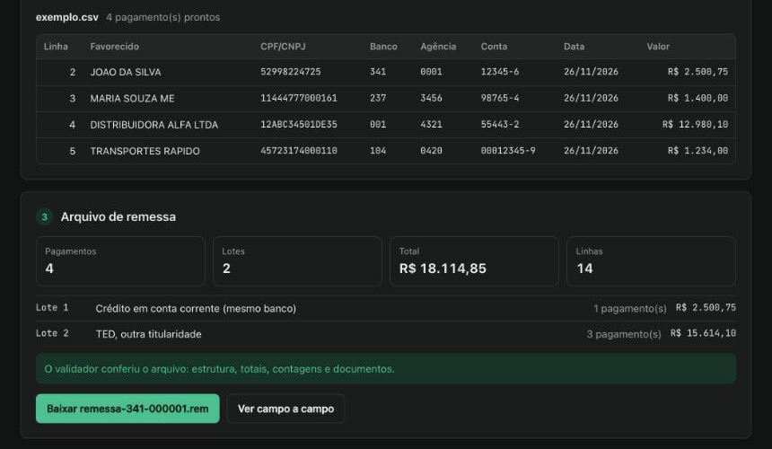

# cnab-generator

Gere e valide arquivos de remessa de pagamentos CNAB 240 (FEBRABAN) a partir de uma planilha, no navegador.

**[Abrir o app](https://alajter.github.io/cnab-generator/)** · [English](README.md) · [Guia da planilha](docs/guia.md) · [Roadmap](docs/product/roadmap.md)



## Para quem é

Para quem precisa gerar a remessa de pagamentos da empresa e não quer descobrir os detalhes do layout pelo código de rejeição do banco: desenvolvedores integrando pagamentos e equipes financeiras que montam os pagamentos numa planilha.

## O que faz

- **Gera** a remessa CNAB 240 a partir de CSV ou Excel. Os dados da empresa pagadora vão num formulário; cada pagamento é uma linha da planilha.
- **Valida** qualquer arquivo de remessa CNAB 240 de pagamentos, inclusive os gerados por outros sistemas. Cada problema aparece com linha, campo e posições, e o visualizador mostra o valor de cada campo.
- **Roda inteiro no navegador.** Nomes, CPF/CNPJ, contas e valores não saem da sua máquina. Não existe servidor.
- **CLI e biblioteca** com o mesmo motor, para usar em scripts ou no backend.

## Cuidados que o gerador toma

- **Layout FEBRABAN 240 v11.0** (setembro de 2026): versão do arquivo `103`, versão do lote `046`.
- **Valores em centavos inteiros.** Aceita `2.500,75`, `2500.75` e `2,500.75`. Recusa `1.234` por ser ambíguo, em vez de adivinhar.
- **Datas sem fuso horário.** `2026-01-15` continua sendo dia 15. Avisa sobre fim de semana e data no passado.
- **Lotes separados por forma de lançamento.** Mesmo banco do pagador: crédito em conta (forma 01, câmara 000). Outros bancos: TED (forma 41, ou 43 quando a conta é da própria empresa), câmara 018, ou 988 quando há ISPB.
- **CPF e CNPJ com dígito verificador**, incluindo o **CNPJ alfanumérico** a partir de julho de 2026.
- **Texto em maiúsculas, sem acento, linhas com CRLF.** Número que não cabe no campo é erro; nunca é cortado.

## O que ainda não faz

Pix (formas 45 e 47), boletos (segmento J), tributos (segmentos N e O) e leitura do arquivo de retorno. Cada banco pode exigir ajustes ao padrão: confira o manual do seu e a [tabela de compatibilidade](docs/bank-compatibility.md).

## Como usar

**No navegador:** [alajter.github.io/cnab-generator](https://alajter.github.io/cnab-generator/). Clique em *Usar dados de exemplo* para ver o fluxo completo.

**Na linha de comando:**

```sh
git clone https://github.com/alajter/cnab-generator && cd cnab-generator
npm ci && npm run build:cli
node dist-cli/cnab.mjs gerar examples/pagamentos.csv --pagador examples/pagador.json --nsa 1
node dist-cli/cnab.mjs validar remessa-pagamentos.rem
```

As colunas da planilha e os erros mais comuns estão no [guia](docs/guia.md).

## Ajude a validar nos bancos

Os testes garantem que o arquivo segue o manual FEBRABAN. Falta confirmar, banco por banco, que os sistemas de cada um aceitam. Se você enviar uma remessa gerada aqui, [conte o resultado](https://github.com/alajter/cnab-generator/issues/new?template=bank-result.yml), mesmo que tenha sido rejeitada.

## Licença

MIT. Feito por [André Lajter](https://github.com/alajter). Não é afiliado à FEBRABAN nem a nenhum banco.
